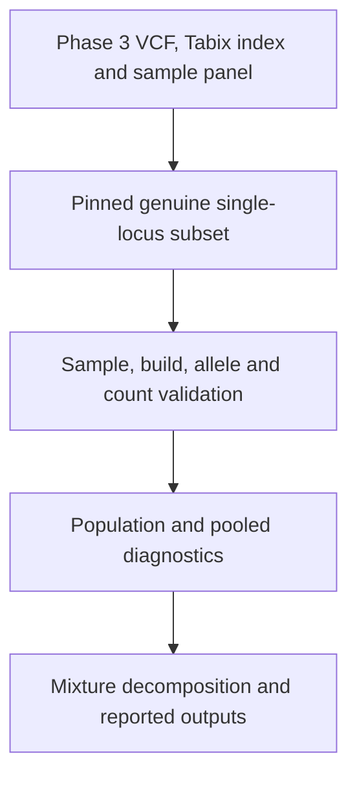

# Project 08: Analytical Workflow

## Scope and analytical design

The analysis audited genotype structure at one biologically interpretable marker,
rs4988235, using the full historical Phase 3 sample panel. The marker was selected
for its published lactase-regulatory context, not from a genome-wide search for
small p-values. No phenotype, association estimate, ancestry inference, or
clinical prediction was produced.

The design compared the same participants under three partitions: 26 source
populations, five source super-populations, and the pooled panel. It used counts
from the actual VCF, not summary frequencies reconstructed into genotypes.

## Source acquisition and data flow



The authoritative collection is [1000 Genomes / IGSR](https://www.internationalgenome.org/data/).
The original file is
[ALL.chr2.phase3_shapeit2_mvncall_integrated_v5a.20130502.genotypes.vcf.gz](https://1000genomes.s3.amazonaws.com/release/20130502/ALL.chr2.phase3_shapeit2_mvncall_integrated_v5a.20130502.genotypes.vcf.gz),
with its [Tabix index](https://1000genomes.s3.amazonaws.com/release/20130502/ALL.chr2.phase3_shapeit2_mvncall_integrated_v5a.20130502.genotypes.vcf.gz.tbi).
Sample labels are taken unchanged from
[integrated_call_samples_v3.20130502.ALL.panel](https://1000genomes.s3.amazonaws.com/release/20130502/integrated_call_samples_v3.20130502.ALL.panel).

`20130502` is the source release-directory identifier. The retained VCF has
`fileDate=20150218`, `source=1000GenomesPhase3Pipeline`, and an hs37d5 reference
header. It should not be described as a file produced in May 2013.

`retrieve_source_subset.py` uses Python's standard library to:

1. Read the first 65,536 compressed bytes and retain all original VCF header lines.
2. Fetch the small chromosome-specific Tabix index and validate its VCF schema.
3. Locate the linear-index window containing the zero-based position 136608645.
4. Read from its compressed lower-bound offset through the next distinct bound,
   plus one maximal BGZF block. The verified request was bytes
   744253887–744407589: 153,703 compressed bytes.
5. Decode complete BGZF blocks and select exactly one complete line matching
   chromosome, position, rsID, REF, and ALT. Incomplete trailing range blocks are
   excluded; the selected source row must be complete.
6. Retrieve the original sample panel and verify both resulting files against
   the committed manifest before writing either one.

A server that ignores Range is rejected before a full VCF body is read. The
helper targets this simple SNP and chromosome-specific index, not arbitrary
VCFs or structural variants. The AWS mirror is explicitly linked by IGSR;
the workflow does not issue range queries to IGSR's rate-limited FTP service.

The committed subset contains all original header lines and the unchanged locus
row. All 2,504 sample columns are retained. Re-fetching never changes the pinned
manifest automatically. Input hash mismatches require a new reviewed snapshot.

## Reference and source assessment

On 2026-10-05, the active [NCBI dbSNP report](https://www.ncbi.nlm.nih.gov/snp/rs4988235)
listed rs4988235 and GRCh37 placement `NC_000002.11:g.136608646G>A`; the report
was not presented as withdrawn. Its separate 1000 Genomes count of 808/5,008
matched this analysis. `data/reference_assessment.csv` records this manual review.

The current dbSNP page also lists other alleles and GRCh38 coordinates.
The retained call-set record is specifically GRCh37 G>A; no liftover,
alternate-allele aggregation, or substitution with the newer 30X collection
was performed. This is an archived release choice, not a claim to use the
latest available sequencing.

## Input validation

`analyze_population_structure.R` checks input hashes before analytical work.
`read_inputs()` then enforces:

- Exactly one VCF header and one variant, with matching field counts.
- Expected hs37d5 reference and historical pipeline/file-date metadata.
- Exact chr2:136608646, rs4988235, G>A identity, PASS filter, and GT-only format.
- Unique sample IDs in both files and identical sample sets.
- Sample metadata reordered by ID, never joined merely by row position.
- Expected 2,504 samples, 26 populations, and five super-populations.
- Complete labels and one super-population assignment for each population.
- Diploid 0/1 alleles; partial or wholly missing genotypes counted as missing.
- Computed ALT count equal to AC, called chromosome count equal to AN, and
  frequency agreeing with the source's rounded AF within 0.000005.

The original panel has two empty trailing header fields. Its bytes are preserved;
the project `.gitattributes` exempts that exact source file from whitespace checks.
R reads the four populated columns and ignores the unused empty fields. Gender
is retained only as original metadata and is not an analytical predictor.

## Statistical calculations

### Counts, frequencies and uncertainty

Let `n0`, `n1`, and `n2` be the GG, GA, and AA counts, and let
`N = n0 + n1 + n2` count called participants. ALT frequency is
`p = (n1 + 2*n2)/(2*N)`. Observed heterozygosity is `Ho = n1/N`;
the group-specific HWE expectation is `He = 2*p*(1-p)`.
The descriptive deficit coefficient is `F = 1 - Ho/He`, left undefined when
`He=0`. It is not an individual inbreeding estimate or a causal diagnosis.

Carrier fraction is `(n1+n2)/N`. The reported 95% Wilson interval uses that
individual-level binary count, with the usual normal quantile `z`:

```text
center = (carrier_fraction + z^2/(2*N)) / (1 + z^2/N)
half_width = z*sqrt(carrier_fraction*(1-carrier_fraction)/N + z^2/(4*N^2))
             / (1 + z^2/N)
```

Boundary groups retain nonzero upper uncertainty when no carriers are observed.
The intervals assume independent participants and a binomial sampling model.
They do not transform a convenience reference panel into a representative survey.
No chromosome-binomial confidence interval was used.

### Exact HWE diagnostic and multiple testing

The probability-ordered two-sided exact test conditions on `N` and the observed
ALT allele count `m = n1 + 2*n2`. For each feasible heterozygote count `h` with
the same parity as `m`, set `a = (m-h)/2` and `g = N-h-a`. Its unnormalized
probability is proportional to `2^h/(g! h! a!)`.

`hwe_exact()` evaluates log weights using `lgamma`, subtracts their maximum
before exponentiation, and normalizes. The p-value sums states whose probability
is no larger than the observed state's probability, using a small relative
tolerance for numerical ties. The method follows Wigginton et al. (2005),
doi:10.1086/429864; the implementation does not copy their software.

Population testing was restricted to the 17 polymorphic groups. Their p-values
were adjusted together with `p.adjust(..., "BH")`, and `q<0.05` was the reported
threshold. Nine monomorphic groups have p=1 as a degenerate conditional result,
`hwe_informative=FALSE`, and blank q/F fields. They provide no HWE-test evidence.
Pooled and five-group p-values are unadjusted diagnostic comparisons, outside
this population-test family. No variant was automatically excluded by these tests.

### Heterozygosity decomposition

For a partition into groups `i`, use called-sample weights `wi=Ni/sum(Ni)` and
frequencies `pi`. Define `pbar=sum(wi*pi)` and
`Hwithin=sum(wi*2*pi*(1-pi))`. The exact sample-frequency identity is:

```text
2*pbar*(1-pbar) - Ho
  = 2*sum(wi*(pi-pbar)^2) + (Hwithin - Ho)
```

The first term is the between-group component; the second is the within-group
residual. Each partition is reconciled to the same pooled allele frequency.
Both the variance identity and additive accounting are checked to 1e-12.
The component fraction is first-term / total deficit. It is a descriptive
partition, not a causal or variance-explained estimate. In other datasets it
could exceed 1 if within-group heterozygosity is above its expectation; the code
does not artificially clamp it to a percentage range.

## Verified results

The actual R run produced GG/GA/AA counts of **1,893/414/197**, no missing calls,
and ALT frequency **808/5,008 = 0.161341853**. The pooled exact HWE p-value was
**2.008113 × 10⁻⁶⁷**; none of 17 population tests had BH q<0.05.

| Quantity | 26-population partition | Five-group partition |
| --- | ---: | ---: |
| Pooled HWE expectation | 0.270621319 | 0.270621319 |
| Weighted within-group HWE expectation | 0.172028839 | 0.200653810 |
| Observed heterozygosity | 0.165335463 | 0.165335463 |
| Total deficit | 0.105285856 | 0.105285856 |
| Between-group component | 0.098592480 | 0.069967509 |
| Within-group residual | 0.006693376 | 0.035318347 |
| Between-group fraction of deficit | 93.6427% | 66.4548% |

Thus the five broader groups retain heterogeneity that the finer labels partly
resolve. The residual cannot distinguish finite-sample variation, unmodeled
structure, relatedness, technical effects, or biological processes.

## Validation and reproducibility evidence

The complete analysis ran in **R 4.3.3 on Ubuntu 24.04.3**, using only base R
packages. `outputs/session_info.txt` records the actual environment. All
16 tests passed; their log is retained in `outputs/test_results.txt`.

Tests cover authentic file identity, allele/genotype totals, source labels,
partition reconciliation, monomorphic handling, the testing family, Wilson
boundary behavior, malformed inputs, build/AC rejection, and reordered metadata.
An independent exhaustive enumeration of allele positions for the first six
genuine participants validates the exact-test calculation. Those mathematical
null configurations are test calculations, not generated biological data.
An independent Python count also agreed with pooled genotypes and the
heterozygosity decomposition; R generated all analytical output files.

The retrieval helper successfully re-fetched both source files, and the bytes
matched their pinned hashes. The actual index and byte ranges were verified.
A clean R rerun reproduced all five numerical CSVs byte for byte. The offline
workflow never requires a fresh web lookup for numerical
reproduction. Live source status is a dated assessment, not guaranteed by
offline tests. Updated source records are not silently accepted.

## Reproduction commands

Install R 4.3 or newer from [CRAN](https://cran.r-project.org/). There are no R
package-install commands because only base packages are required. Python 3.10+
is optional for verification/retrieval and uses no additional packages.

Run from the repository root:

```bash
cd genomics-practice-08-r-population-genotype-structure
Rscript --vanilla tests/test_genotype_functions.R
Rscript --vanilla analyze_population_structure.R
```

Optional network-independent source verification and explicit re-fetch:

```bash
python3 retrieve_source_subset.py
python3 retrieve_source_subset.py --refresh
```

Numerical CSVs should reproduce the committed values. PNG/SVG font rendering
and serialized metadata can differ across R platforms. The session file should
record the environment that actually reran the analysis.

Review and commit from the repository root after importing this project:

```bash
git status --short
git diff -- README.md
git add README.md genomics-practice-08-r-population-genotype-structure
git --no-pager diff --cached --check
git --no-pager diff --cached --stat
git status --short
git commit -m "Add population genotype structure audit"
git push origin main
```

Inspect staged paths before committing. If unrelated changes are already staged,
resolve them separately first; the commit should contain this project and its
portfolio entry. No force push, reset, or deletion of existing work is required.

## Limitations and communication

The source calls are historical integrated reference-panel genotypes. This
single-locus record contains GT rather than per-sample depth, genotype likelihood,
or quality fields, so call-level sequencing quality cannot be audited here.
Sample labels do not measure genome-wide ancestry or relatedness. HWE assumptions
and test power require caution, especially for low-frequency alleles.

The correct stakeholder conclusion is that pooled genotype checks can be
confounded by source-population mixture. These results do not establish clinical
utility, natural selection, dietary suitability, or phenotype prevalence.
Full biological context, usage terms, and publication references are recorded
in the project README.
