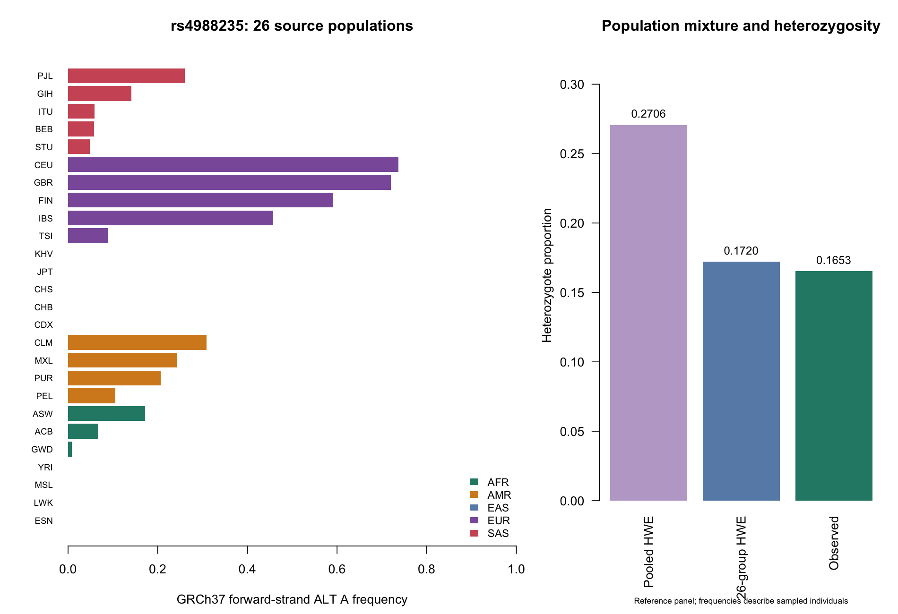

# Project 08: Population Genotype Structure Audit

## Project overview

This R project quantified allele and genotype frequencies at **rs4988235** in
the complete 2,504-person 1000 Genomes Phase 3 reference panel. It compared
Hardy–Weinberg equilibrium (HWE) diagnostics across 26 source populations,
five broader source groups, and the pooled panel, then decomposed the pooled
heterozygote deficit into between-population frequency variation and a remaining
within-population component.

The analysis used one genuine biallelic variant record and every sample in its
historical release. The statistical results and graphics were generated with
R 4.3.3; 16 automated tests passed. No phenotypes were analyzed.

## Analytical question

How much of the pooled heterozygote deficit at rs4988235 reflects differences
in allele frequency between source populations, and does the pooled HWE
diagnostic agree with population-specific diagnostics?

## Biological or clinical context

rs4988235 lies within MCM6 in a regulatory region associated with LCT expression
and adult lactase persistence. The historic literature's −13910 C>T notation
corresponds to **G>A on the genomic forward strand** used here. Lactase
persistence has multiple genetic contributors, including other regulatory
variants reported in African populations. This single marker cannot describe
that phenotype universally or support individual dietary advice.

HWE describes expected genotype proportions under a population model. Pooling
groups with different allele frequencies can reduce observed heterozygosity
relative to the pooled expectation, a pattern commonly called the Wahlund effect.
This project assessed that arithmetic contribution without attributing the
remaining difference to a particular biological cause.

## Data source

| Item | Exact source or identifier |
| --- | --- |
| Collection | [1000 Genomes Phase 3 / IGSR](https://www.internationalgenome.org/data/) |
| Call set | Integrated v5a, directory `release/20130502`; source VCF `fileDate=20150218` |
| Genome reference | GRCh37 / hs37d5; source header retained |
| Variant | [rs4988235](https://www.ncbi.nlm.nih.gov/snp/rs4988235), `NC_000002.11:g.136608646G>A` |
| Analysis subset | One PASS SNP at chr2:136608646, all 2,504 source samples |
| Original chromosome VCF | [ALL.chr2.phase3_shapeit2_mvncall_integrated_v5a.20130502.genotypes.vcf.gz](https://1000genomes.s3.amazonaws.com/release/20130502/ALL.chr2.phase3_shapeit2_mvncall_integrated_v5a.20130502.genotypes.vcf.gz) |
| Retrieval index | [Original Tabix index](https://1000genomes.s3.amazonaws.com/release/20130502/ALL.chr2.phase3_shapeit2_mvncall_integrated_v5a.20130502.genotypes.vcf.gz.tbi) |
| Sample labels | [integrated_call_samples_v3.20130502.ALL.panel](https://1000genomes.s3.amazonaws.com/release/20130502/integrated_call_samples_v3.20130502.ALL.panel) |
| Retrieval and record review | 2026-10-05 |

The original VCF is approximately 1.31 GB. The retrieval helper reads bounded
byte ranges from the AWS mirror linked by IGSR and preserves the original
header and exact locus row. It does not recreate calls. The committed VCF is
46,078 bytes; the unchanged source panel is 55,156 bytes.

## Reference or data-quality assessment

The current dbSNP report remained active on the review date and provided
the GRCh37 placement. Its independently reported 1000 Genomes count,
808/5,008, matched the VCF and calculated calls. The current report also lists
G>C and G>T changes and a GRCh38 placement; this project deliberately retained
the historic Phase 3 G>A record on GRCh37, without combining those other alleles
or builds.

Checks confirmed unique sample IDs, exact sample-set agreement, one-to-one
population labels, diploid biallelic calls, PASS status, and reconciliation with
source AC, AN, and rounded AF fields. There were no missing genotypes. Pinned
file hashes and byte counts are recorded in `data/source_manifest.csv`.

## Data usage

The [IGSR disclaimer](https://www.internationalgenome.org/IGSR_disclaimer/)
states that 1000 Genomes data are available without embargo and should be cited;
[EMBL-EBI terms](https://www.ebi.ac.uk/about/terms-of-use/) and relevant third-party
rights also apply. No blanket Creative Commons license is asserted for these
data. The original project publication is cited below. The genuine subset is
retained for reproducibility with its source attribution.

Only public reference-panel identifiers were used. No identities were inferred,
no private clinical information was joined, and results were reported in
aggregate. Source population and super-population labels describe the collection;
they are not inferred genetic ancestry, racial categories, or clinical labels.

## Methods

- Parsed phased diploid GT calls into counts of genomic-forward ALT A copies.
- Calculated GG/GA/AA counts, allele frequency, carrier fraction, observed
  heterozygosity, HWE expectation, and heterozygote-deficit coefficient.
- Calculated probability-ordered two-sided exact HWE p-values with conditional
  genotype-state enumeration and stable log-factorial probabilities.
- Applied Benjamini–Hochberg (BH) correction to the 17 polymorphic population
  tests. Nine monomorphic populations were flagged as uninformative.
- Calculated 95% Wilson intervals for carrier proportions among individuals,
  rather than assuming independence between a person's two chromosomes.
- Reconciled the pooled deficit with sample-weighted frequency variation across
  both fine and coarse source partitions.

Details, formulae, validation, and reproduction commands are in
[ANALYSIS_WORKFLOW.md](ANALYSIS_WORKFLOW.md).

## Results

| Verified measure | Result |
| --- | ---: |
| Called participants / missing calls | 2,504 / 0 |
| Pooled GG / GA / AA genotypes | 1,893 / 414 / 197 |
| ALT A allele count / total chromosomes | 808 / 5,008 |
| Pooled A frequency | 0.161342 |
| Pooled carrier fraction; 95% Wilson interval | 0.244010; 0.227587–0.261216 |
| Observed heterozygosity | 0.165335 |
| Pooled HWE expected heterozygosity | 0.270621 |
| Pooled exact HWE p-value | 2.008113 × 10⁻⁶⁷ |
| Population tests with BH q < 0.05 | 0 of 17 informative tests |
| 26-population weighted HWE expectation | 0.172029 |
| Between-population component / total deficit | 93.64% |
| Five-group between-component / total deficit | 66.45% |

| Source group | Participants | A count | A frequency |
| --- | ---: | ---: | ---: |
| AFR | 661 | 36 | 0.027231 |
| AMR | 347 | 150 | 0.216138 |
| EAS | 504 | 0 | 0.000000 |
| EUR | 503 | 511 | 0.507952 |
| SAS | 489 | 111 | 0.113497 |

AFR, AMR, EAS, EUR, and SAS are the source's African, Admixed American, East
Asian, European, and South Asian group labels, respectively. Full population
counts and results are retained in CSV files.



## Interpretation

The pooled HWE departure was substantially larger than the residual after
accounting for frequency differences among the 26 source populations. Fine
population labels accounted for more heterogeneity than the five broader groups.
For example, the European group itself showed a small unadjusted HWE p-value
(9.47 × 10⁻⁹), despite no population passing the population-test BH threshold.

These observations caution against discarding this variant solely because of
its pooled HWE diagnostic. The 93.64% result is an algebraic decomposition of
this sample's deficit, not a causal estimate. Absence of a significant
population-specific result does not establish equilibrium or validate every call.

## Output files

| File in `outputs/` | Contents |
| --- | --- |
| `population_genotype_summary.csv` | 26 population counts, frequencies, carrier intervals, exact HWE p-values, and BH q-values |
| `super_population_summary.csv` | Five source-group summaries; unadjusted diagnostic p-values |
| `pooled_genotype_summary.csv` | Whole-panel genotype and diagnostic summary |
| `heterozygosity_decomposition.csv` | Exact sample-weighted decomposition for two partitions |
| `source_qc.csv` | Sample, call, allele, and testing accounting |
| `population_structure_overview.png` and `.svg` | R-generated frequency and heterozygosity graphics |
| `population_structure_report.md` | Generated numerical result report |
| `session_info.txt` | R version, platform, and input manifest |
| `test_results.txt` | Verified automated-test log |

## Reproducibility

The committed data support offline analysis. Install R 4.3 or newer; only base R
packages are required. Optional source retrieval requires Python 3.10 or newer
with its standard library, without pip dependencies.

From the repository root:

```bash
cd genomics-practice-08-r-population-genotype-structure
Rscript --vanilla tests/test_genotype_functions.R
Rscript --vanilla analyze_population_structure.R
```

To verify the committed data or explicitly retrieve the same genuine subset:

```bash
python3 retrieve_source_subset.py
python3 retrieve_source_subset.py --refresh
```

`make all` combines local verification, tests, and analysis when Make and Python
are available. Source mismatches stop the workflow rather than replace the pinned
data. Tabular numerical results are reproducible; graphics and session metadata
may differ in serialization or font rendering across platforms.

## Technical competencies demonstrated

Versioned call-set selection; BGZF/Tabix subset retrieval; sample-ID joins;
assembly and allele-orientation validation; reusable R functions; exact
conditional tests; multiple-testing control; population-structure diagnostics;
algebraic result reconciliation; automated rejection checks; and cautious
aggregate communication of human reference-panel results.

## Limitations

- One preselected marker does not characterize genome-wide structure or establish
  an association, predictive model, selection signal, or genotype-calling defect.
- The historical low-coverage integrated calls lack per-sample quality scores in
  this GT-only record. PASS is not an independent laboratory validation.
- Source labels do not eliminate within-group structure, admixture, or relatedness.
  No genome-wide relatedness assessment was performed.
- Small samples and rare alleles limit HWE-test power; monomorphic results are
  uninformative for this diagnostic.
- Wilson intervals assume independent individuals and a binomial sampling model.
  This reference panel is not a random survey; intervals are descriptive and
  must not be presented as population-prevalence estimates.
- No lactase phenotype or clinical outcome was available. Zero observed A copies
  in a sampled group does not imply absence of lactase persistence in that group.

## References

1. 1000 Genomes Project Consortium. *A global reference for human genetic
   variation.* Nature (2015). [doi:10.1038/nature15393](https://doi.org/10.1038/nature15393).
2. Wigginton JE, Cutler DJ, Abecasis GR. *A note on exact tests of Hardy–Weinberg
   equilibrium.* American Journal of Human Genetics (2005).
   [doi:10.1086/429864](https://doi.org/10.1086/429864).
3. Tishkoff SA et al. *Convergent adaptation of human lactase persistence in
   Africa and Europe.* Nature Genetics (2007).
   [doi:10.1038/ng1946](https://doi.org/10.1038/ng1946).
4. [NCBI dbSNP rs4988235 report](https://www.ncbi.nlm.nih.gov/snp/rs4988235),
   [IGSR data access](https://www.internationalgenome.org/data/), and
   [IGSR reuse terms](https://www.internationalgenome.org/IGSR_disclaimer/),
   reviewed 2026-10-05.
