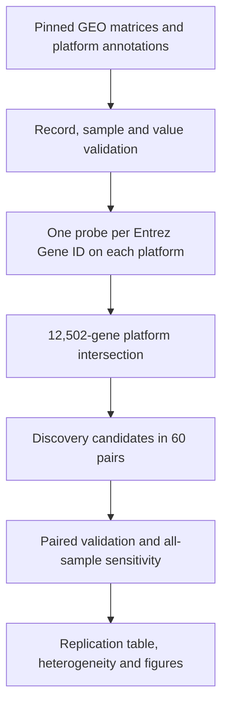

# Project 09: Analytical Workflow

## Scope and analytical design

Project 05 identified paired tumor–normal expression differences in GSE19804.
Project 09 asks a distinct question: do large GSE19804 effects reproduce in a
second cohort collected by another group and measured on another array platform?

The design separates discovery from validation:

- **Discovery:** all 60 complete GSE19804 tumor–adjacent-normal pairs on GPL570.
- **Primary validation:** the 33 complete tumor–non-tumor pairs recoverable from
  the 107 final GSE10072 profiles on GPL96.
- **Validation sensitivity:** all 107 GSE10072 profiles, with standard errors
  clustered across the 74 participant IDs.

No GSE10072 value influenced the discovery candidate definition. Both datasets
were reprocessed from their original normalized GEO Series Matrix files so the
project is independently reproducible and does not depend on a generated output
from another portfolio directory.

## Data flow



## Source acquisition and identity

`expression_replication.py` defines four immutable source specifications:

| File | Bytes | MD5 |
| --- | ---: | --- |
| `GSE19804_series_matrix.txt.gz` | 21,530,998 | `c817eb7b8b74d1cbdd4db7580fb9ea08` |
| `GPL570.annot.gz` | 8,471,521 | `be9fdbdb62e45257f2d3177a32f9a518` |
| `GSE10072_series_matrix.txt.gz` | 13,021,909 | `73273a4efa1d8e63777d7792b9bbabaf` |
| `GPL96.annot.gz` | 4,522,748 | `a3c03c05e7b77d2305b84ba5e46181ec` |

Each URL points directly to the NCBI GEO FTP-over-HTTPS archive. Missing files
are streamed to a `.partial` path and atomically renamed only after download.
Every run verifies size and MD5. A cached file with altered bytes stops the
workflow; it is not automatically refreshed or accepted.

The exact URLs and the retrieval date, 2026-10-12, are retained in
`data/source_manifest.csv`. `--no-download` converts absence into an error and
supports controlled offline reproduction.

## Record and sample validation

The Series Matrix parser requires:

- one exact Series accession and expected platform accession;
- a GEO status beginning `Public on`;
- one title, GSM accession, and source field per expression column;
- source dimensions of 54,675 × 120 for GSE19804 and 22,283 × 107 for GSE10072;
- exact expression-column alignment with the GSM metadata;
- unique probes and GSMs, finite numeric values, and a plausible 0–25 range for
  the deposited normalized log-scale values;
- participant and tissue labels that match cohort-specific source patterns.

GSE19804 participant IDs are extracted from titles ending in a numeric ID plus
`T` or `N`; tissue is confirmed from the source-name field. GSE10072 participant
IDs use the `GT` suffix in the title; tissue must be exactly `Adenocarcinoma of
the Lung` or `Normal Lung Tissue` in the source field. Pair construction groups
by participant ID and admits only a participant with exactly one profile for
each tissue. Pair order is therefore independent of source column order.

The GSE10072 record states that 122 profiles remained after quality and tissue
review and that 15 technical duplicates were averaged, yielding 107 final
expression values. The deposited matrix contains those 107 values: 58 tumor and
49 non-tumor profiles from 74 distinct participant IDs, including 33 complete
pairs. No averaging was repeated and no missing counterpart was imputed.

## Cross-platform mapping

Both GEO platform files contain probe ID, Entrez Gene ID, gene symbol, and title.
A probe is eligible only when `Gene ID` is one numeric identifier and `Gene
symbol` is a single nonempty symbol without the annotation's multi-mapping `/`
delimiter. This avoids splitting ambiguous platform rows into unsupported
pseudo-records.

Many genes retain multiple eligible probes. Within each platform, the
representative probe is the one with the largest interquartile range across all
samples. This criterion uses expression values but not tissue labels. Ties are
resolved lexicographically by probe ID. The selection is performed separately
because probe coverage and variability differ across GPL570 and GPL96.

The two unique Entrez tables are intersected, leaving 12,502 common genes. Gene
ID is the cross-platform key. Discovery symbols and titles are retained for
readability; the source probe IDs and IQR values from both platforms remain in
the result table for audit.

## Paired statistical model

For gene `j` and complete pair `i`, define the deposited log2-scale difference:

```text
d_ij = tumor_ij - normal_ij
```

For `n` complete pairs, the effect is the mean difference, its standard error is
`sd(d_j)/sqrt(n)`, and the two-sided statistic is evaluated against a t
distribution with `n-1` degrees of freedom. The 95% interval uses the same
standard error and t critical value. A zero-variance, zero-effect vector is
assigned p=1; a zero-variance nonzero vector is assigned p=0. No such exception
was required for the 12,502 production tests.

Paired analysis controls participant characteristics that do not change between
the two specimens. It does not control tissue sampling differences, local field
effects, cellular composition, or measurement artifacts shared with tissue type.

## Discovery and validation families

Benjamini–Hochberg adjusted values are calculated by stable p-value ordering,
rank multiplication, reverse cumulative minima, restoration to source order,
and clipping to [0,1]. The two test families are explicit:

1. **Discovery family:** 12,502 two-sided paired tests. A candidate has q≤0.05
   and `|mean difference|≥1.0` log2 unit. This selected 990 genes.
2. **Validation family:** the 990 pre-specified candidates, evaluated with
   two-sided paired p-values in GSE10072 and BH adjusted together. Replication
   requires q≤0.05, the same effect direction, and `|mean difference|≥0.5`.

The validation rule is two-sided even though a direction is required. This is
more conservative than converting the discovery direction into a one-sided
hypothesis after observing discovery data. Of 990 candidates, 956 had the same
direction, 899 had validation q≤0.05, and 770 jointly met validation q, direction,
and effect requirements.

The thresholds are analysis rules chosen before inspecting the produced results.
They do not represent clinical cutoffs or control the false discovery rate of a
future clinical decision process.

## All-sample validation sensitivity

The sensitivity analysis uses all 107 GSE10072 profiles in the linear model:

```text
expression = intercept + beta_tissue * I(tumor) + error
```

Because 33 participants contribute both tissues, ordinary independent-sample
standard errors would be invalid. The implementation forms the OLS estimate and
participant-clustered sandwich covariance. If `X_g` and `u_g` are design rows and
residuals for participant cluster `g`, the covariance is:

```text
(X'X)^-1 [sum_g (X_g' u_g)(X_g' u_g)'] (X'X)^-1
```

It is multiplied by `G/(G-1) * (N-1)/(N-k)` for 74 clusters, 107 observations,
and two model coefficients. The tissue statistic uses `G-1=73` reference degrees
of freedom. A candidate passes sensitivity only when its clustered two-sided
p-value is below 0.05 and its direction matches discovery.

This sensitivity condition can remove but cannot add a replicated gene. It
removed two of the 770 paired-validation selections, leaving 768. Because the
unmatched tissue groups can differ in smoking, sex, stage, and other participant
features, this model is a robustness screen rather than the primary effect
estimate. Its p-values are not a third discovery family and are not presented as
independent confirmation.

## Effect synthesis and heterogeneity

For each of the 768 replicated genes, the two paired cohort effects are combined
with inverse-variance weights `w_k=1/se_k^2`:

```text
fixed effect = sum(w_k * effect_k) / sum(w_k)
SE = sqrt(1 / sum(w_k))
```

Cochran's `Q=sum(w_k*(effect_k-fixed effect)^2)` has one degree of freedom.
`I²=max(0,(Q-1)/Q)` when Q>0. With only two cohorts, both Q and I² are imprecise.
They are included as transparency diagnostics, not as evidence identifying a
source of heterogeneity. A random-effects variance would also be unstable with
two studies, so it was not substituted as a seemingly more general primary
summary.

The fixed-effect calculation is descriptive. Cohort-specific effects and
intervals remain the primary replication evidence. Of 768 replicated genes,
462 (60.2%) had I²>0.5, reinforcing this boundary.

## Verified results

| Stage | Count |
| --- | ---: |
| Common genes tested | 12,502 |
| Discovery candidates | 990 |
| Same validation direction | 956 |
| Validation q, direction, and effect rule | 770 |
| Final replicated set after sensitivity | 768 |
| Higher / lower in tumor | 258 / 510 |

Across all common genes, the discovery and validation effects had Spearman
ρ=0.7431496. Scipy's two-sided p-value underflowed to numerical zero at this
sample size; the effect correlation is the informative quantity. Across the 990
discovery candidates, Pearson r was 0.8873866. Candidate correlation is selected
on the discovery axis and is descriptive, not an unbiased population parameter.

Leading absolute fixed-effect summaries were:

| Gene | GSE19804 | GSE10072 | Fixed effect | I² |
| --- | ---: | ---: | ---: | ---: |
| SPP1 | 4.503 | 4.381 | 4.438 | 0.000 |
| AGER | -4.398 | -4.350 | -4.370 | 0.000 |
| FABP4 | -3.747 | -3.798 | -3.780 | 0.000 |
| WIF1 | -3.774 | -3.599 | -3.665 | 0.000 |
| TMEM100 | -3.565 | -3.715 | -3.641 | 0.000 |
| SFTPC | -3.269 | -3.938 | -3.636 | 0.662 |
| CLDN18 | -4.161 | -3.486 | -3.618 | 0.621 |
| COL11A1 | 3.976 | 3.305 | 3.615 | 0.493 |
| FCN3 | -3.405 | -3.654 | -3.549 | 0.000 |
| COL10A1 | 4.258 | 2.765 | 3.526 | 0.931 |

The signed effects are tumor minus normal on each source's normalized log2 scale.
They should not be converted directly into absolute RNA abundance.

## Automated and independent validation

`tests/` contains only the test program, a fixture manifest, and four compressed
fixtures. The fixtures are genuine disclosed subsets generated by retaining the
original GEO metadata plus the authentic rows for AGER, COL11A1, FABP4, and SPP1
across every deposited sample. Their source accessions, sizes, and MD5 hashes are
recorded in `tests/fixture_manifest.csv`. They are not simulated matrices.

Fourteen tests verify:

- fixture and production-source identities;
- cohort dimensions, tissue counts, unique participant counts, and exact pair
  reconstruction;
- platform annotation and one-gene/one-probe output;
- authentic paired effects for four genes in both cohorts;
- invariance to sample/metadata order;
- BH calculations and invalid-p rejection;
- clustered OLS effect and variance against a separately coded scalar sandwich
  calculation;
- fixed-effect weight reconciliation and invalid standard-error rejection;
- complete production-output accounting and exact threshold application;
- rejection of an incorrect Series identity.

An additional validation pass recalculated summary counts directly from the
full result CSV and visually inspected the PNG figure for legibility, axes,
direction, interval marks, and legend agreement. The production analysis was
rerun from the four pinned source files; its numerical CSV outputs were compared
for byte-identical regeneration.

## Reproduction commands

From the repository root:

```bash
cd genomics-practice-09-python-cross-cohort-expression-replication
python3 -m venv .venv
source .venv/bin/activate
python3 -m pip install -r requirements.txt
python3 analyze_cross_cohort_replication.py
python3 -m unittest discover -s tests -v
```

To require an existing verified source cache:

```bash
python3 analyze_cross_cohort_replication.py --no-download
```

The generated numerical CSVs are deterministic for the pinned inputs and listed
dependency ranges. PNG and SVG serialization, font metrics, and metadata can
differ between Matplotlib or operating-system versions.

## Review and safe Git commands

Run from the repository root after importing the project:

```bash
git status --short
git diff -- README.md
git add README.md genomics-practice-09-python-cross-cohort-expression-replication
git --no-pager diff --cached --check
git --no-pager diff --cached --stat
git status --short
git commit -m "Add cross-cohort expression replication project"
git push origin main
```

Inspect the staged paths before committing. If Project 08 or another change is
still pending, commit it separately first so each portfolio project has a clear
history. No force push, reset, or deletion is required.

## Analytical limitations

This analysis evaluates reproducibility of expression contrasts, not their
causal mechanism. It does not deconvolve bulk tissue, assess histologic purity,
correct raw-array batches, model all cohort covariates, or test diagnostic
performance. Annotation is a pinned GEO snapshot rather than a current transcript-
level reannotation. Cross-platform probe selection can favor different transcript
features even when Entrez IDs match.

The validation cohort was not sampled to estimate a population prevalence, and
the all-sample sensitivity includes unmatched profiles. Study differences are
both a strength for external transfer and a source of effect heterogeneity. No
claim is made that the 768 genes are specific to lung adenocarcinoma, suitable
as biomarkers, or ready for clinical use.
