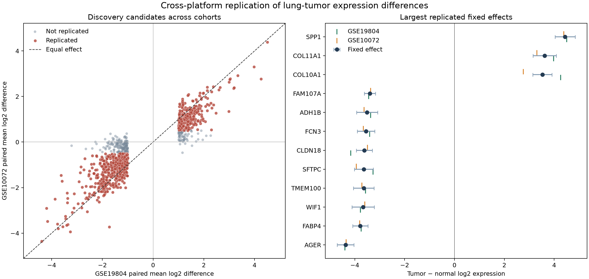

# Project 09: Cross-Cohort Lung-Tumor Expression Replication

## Project overview

This project tested whether gene-expression differences identified in the
Project 05 cohort reproduced in a distinct public lung-adenocarcinoma cohort.
It reprocessed the complete normalized NCBI GEO matrices for GSE19804 and
GSE10072, mapped two Affymetrix platforms through unambiguous Entrez Gene IDs,
and applied a pre-specified discovery-and-validation design.

GSE19804 supplied 60 paired tumor–adjacent-normal comparisons. GSE10072
contained 107 final expression profiles from 74 participants; its 33 complete
tumor–non-tumor pairs formed the primary validation set. An all-sample regression
with participant-clustered standard errors assessed whether conclusions depended
on excluding the 41 participants with only one tissue profile.

All reported results were generated with the downloaded source files. Fourteen
automated tests passed, including calculations on disclosed authentic GEO fixture
subsets and independent checks of the clustered sandwich variance.

## Analytical question

Which large, statistically supported tumor–normal expression differences in
GSE19804 reproduce with the same direction and a material effect size in the
independent GSE10072 cohort, despite differences in platform and cohort composition?

## Biological or clinical context

Lung tumors alter malignant epithelial programs, stromal composition, immune
activity, and the proportions of normal lung cell types. A differential-expression
signal can therefore be biologically reproducible without being tumor-cell-specific
or clinically useful. Independent cohorts help distinguish signals that transfer
across samples and platforms from effects that may be particular to one study.

GSE19804 comprises paired tumor and adjacent normal lung tissue from 60
nonsmoking women in Taiwan. GSE10072 includes lung adenocarcinoma and non-tumor
lung profiles from women and men with different smoking histories. These
differences make GSE10072 a meaningful external replication cohort but also
prevent the combined estimate from being interpreted as one homogeneous target
population.

## Data source

| Cohort or annotation | Exact public record | Analysis use |
| --- | --- | --- |
| Discovery cohort | [GSE19804](https://www.ncbi.nlm.nih.gov/geo/query/acc.cgi?acc=GSE19804), GPL570, 120 profiles | 60 complete tumor–adjacent-normal pairs |
| Validation cohort | [GSE10072](https://www.ncbi.nlm.nih.gov/geo/query/acc.cgi?acc=GSE10072), GPL96, 107 final profiles | 33 complete pairs; all 107 profiles in sensitivity analysis |
| Discovery annotation | [GPL570](https://www.ncbi.nlm.nih.gov/geo/query/acc.cgi?acc=GPL570) | Probe-to-Entrez mapping |
| Validation annotation | [GPL96](https://www.ncbi.nlm.nih.gov/geo/query/acc.cgi?acc=GPL96) | Probe-to-Entrez mapping |
| Discovery publication | Lu et al., PMID [20802022](https://pubmed.ncbi.nlm.nih.gov/20802022/) | Cohort and study context |
| Validation publication | Landi et al., PMID [18297132](https://pubmed.ncbi.nlm.nih.gov/18297132/) | Cohort and study context |

The exact Series Matrix and platform-annotation URLs, file sizes, MD5 hashes,
and retrieval date (**2026-10-12**) are recorded in
`data/source_manifest.csv`. Source files total approximately 45 MB and are
downloaded into the ignored `data/cache/` directory. They are not replaced with
generated values or a convenience dataset.

## Reference or data-quality assessment

All four accessions were active public GEO records when reviewed on 2026-10-12;
the dated assessment is retained in `data/reference_assessment.csv`. The
workflow rejects a source unless its accession, platform, public status,
dimensions, byte count, and MD5 hash match the pinned record.

Additional checks confirmed:

- 54,675 probes by 120 samples for GSE19804 and 22,283 probes by 107 samples
  for GSE10072;
- unique probe and GSM identifiers, finite normalized values, and expected
  log-scale ranges;
- 60 complete GSE19804 pairs and 33 complete GSE10072 pairs reconstructed by
  participant ID rather than column order;
- 58 tumor and 49 non-tumor final profiles from 74 GSE10072 participants;
- exact sample-column agreement between GEO metadata and expression values;
- 12,502 unambiguous Entrez Gene IDs represented on both platforms.

GSE10072's GEO record explains that technical replicate profiles were averaged
by the submitters to form the 107 final values. This analysis used those deposited
final profiles and did not treat the original technical replicates as participants.

## Data usage

The [GEO disclaimer](https://www.ncbi.nlm.nih.gov/geo/info/disclaimer.html)
states that NCBI places no restrictions on GEO data use or distribution, while
noting that submitters may hold rights in portions of deposited material. The
two original studies and accessions are cited, and no universal Creative Commons
license is asserted.

Only public research data were used. Results are aggregated by gene and cohort;
no attempt was made to identify participants, link external records, or infer
individual clinical status. Sample accessions are retained solely for transparent
pair accounting.

## Methods

1. The complete normalized Series Matrix files and platform annotations were
   downloaded from NCBI GEO and verified against pinned identities.
2. Probes with one numeric Entrez Gene ID and one unambiguous gene symbol were
   eligible. Within each platform, one probe per Gene ID was selected by the
   largest across-sample interquartile range, with probe ID as a deterministic
   tie-breaker. Tissue labels were not used in probe selection.
3. The intersection of the two platform-specific gene sets produced 12,502
   tested genes.
4. Paired tumor-minus-normal log2 differences, standard errors, 95% t intervals,
   and two-sided paired t tests were calculated in each cohort.
5. Discovery p-values were Benjamini–Hochberg (BH) adjusted across all 12,502
   genes. Candidates required discovery q ≤ 0.05 and absolute mean difference
   ≥ 1.0 log2 unit.
6. Validation p-values were BH adjusted across the 990 pre-specified candidates.
   Replication required matching direction, validation q ≤ 0.05, absolute
   validation difference ≥ 0.5 log2 unit, and an all-sample sensitivity result
   with matching direction and clustered p < 0.05.
7. The sensitivity model used all 107 validation profiles, a tissue indicator,
   and participant-clustered sandwich standard errors with a finite-cluster
   correction. It could exclude a candidate but could not add one.
8. Inverse-variance fixed-effect summaries, Cochran's Q, and I² were calculated
   for replicated genes. Cohort-specific effects remain primary because only two
   studies were available and heterogeneity was common.

Formulae, validation logic, data flow, and exact commands are documented in
[ANALYSIS_WORKFLOW.md](ANALYSIS_WORKFLOW.md).

## Results

| Verified measure | Result |
| --- | ---: |
| Common Entrez Gene IDs tested | 12,502 |
| Discovery / validation complete pairs | 60 / 33 |
| Discovery candidates | 990 |
| Candidates with the same validation direction | 956 |
| Candidates passing validation q, direction, and effect thresholds | 770 |
| Genes also passing all-sample clustered sensitivity | 768 |
| Replication fraction among discovery candidates | 77.6% |
| Replicated genes higher / lower in tumor | 258 / 510 |
| All-gene cross-cohort Spearman ρ | 0.7431 |
| Discovery-candidate effect Pearson r | 0.8874 |
| Replicated genes with I² > 0.5 | 462 of 768 (60.2%) |

The largest absolute fixed-effect summaries were observed for SPP1, AGER,
FABP4, WIF1, TMEM100, SFTPC, CLDN18, COL11A1, FCN3, and COL10A1. Their cohort
effects and heterogeneity statistics are available in the results table rather
than being reduced to a ranked biomarker claim.



## Interpretation

Most large GSE19804 signals transferred in direction and magnitude to GSE10072,
and the genome-wide effect correlation was substantial. This supports broad
cross-cohort reproducibility of the tumor-versus-non-tumor expression contrast
for these normalized microarray data.

Replication was not uniform. The validation effects were often smaller, and
60.2% of replicated genes had I² above 0.5. With only two cohorts, I² is unstable
and cannot explain heterogeneity, but it warns against presenting the pooled
fixed effect as a universal population estimate. SPP1, AGER, and FABP4 showed
large concordant effects with I² calculated as zero; other leading genes such
as COL10A1 showed substantial between-cohort inconsistency.

The results support analytical transfer, not clinical performance. They do not
show that any gene diagnoses cancer, predicts outcome, represents a tumor-cell-
intrinsic mechanism, or would retain the same effect in RNA-seq or prospective
clinical samples.

## Output files

| File in `outputs/` | Contents |
| --- | --- |
| `cross_cohort_gene_results.csv` | All 12,502 genes, probes, paired statistics, q-values, sensitivity results, and selection flags |
| `replicated_gene_results.csv` | 768 replicated genes with cohort and fixed-effect summaries, Q, and I² |
| `cohort_sample_manifest.csv` | Public GSM, participant, tissue, cohort, and primary-pair accounting |
| `analysis_summary.csv` | Principal sample and result counts plus cross-cohort correlations |
| `cross_cohort_replication.png` and `.svg` | Effect-transfer scatter plot and fixed-effect interval panel |
| `replication_report.md` | Generated numerical results and interpretation boundary |
| `run_metadata.json` | Runtime versions and threshold specification |
| `test_results.txt` | Output from the verified automated test run |

## Reproducibility

Python 3.10 or newer is required. From the project directory:

```bash
python3 -m venv .venv
source .venv/bin/activate
python3 -m pip install -r requirements.txt
python3 analyze_cross_cohort_replication.py
python3 -m unittest discover -s tests -v
```

The first analysis run downloads the four pinned files. Later runs validate the
cache before analysis. To prohibit network retrieval and require an already
validated cache:

```bash
python3 analyze_cross_cohort_replication.py --no-download
```

`make all` runs analysis, tests, and the cache-required verification pass. The
tests themselves do not require the full downloads: they use four explicitly
documented, byte-pinned genuine GEO subsets containing the original metadata
and four authentic gene rows across every deposited sample.

## Technical competencies demonstrated

Cross-study experimental design; authoritative GEO retrieval; source hashing;
microarray metadata parsing; participant-level pair reconstruction; platform-
aware Entrez mapping; deterministic representative-probe selection; paired
inference; BH control in discovery and validation families; cluster-robust
regression; inverse-variance synthesis; heterogeneity assessment; authentic-data
test fixtures; reproducible visualization; and cautious scientific reporting.

## Limitations

- This is a secondary analysis of deposited normalized microarray values. Raw
  CEL preprocessing and laboratory batch effects were not independently repeated.
- Adjacent or non-tumor lung is not equivalent to tissue from a cancer-free
  population, and bulk-tissue differences can reflect cellular composition.
- The cohorts differ in sex distribution, smoking history, geography, platform,
  collection procedures, and tumor eligibility. The paired primary analyses
  control stable person-level factors within each cohort but not these
  between-cohort differences.
- The all-sample clustered sensitivity model uses unmatched profiles and does
  not adjust for smoking, sex, stage, or other potential confounders. It is a
  consistency check, not a replacement for the paired validation result.
- Selecting the highest-IQR probe is deterministic and does not use tissue
  labels, but different probes can measure distinct transcripts or cross-hybridize.
- A two-study fixed-effect summary assumes a common effect. The reported Q and
  I² show that this assumption is often questionable; random-effects variance
  is also poorly estimated from two cohorts.
- The replication thresholds are declared analytical rules, not validated
  clinical cutoffs. No classifier, sensitivity, specificity, prognosis, causal
  inference, treatment recommendation, or clinical decision rule was developed.

## References

1. Lu TP et al. Identification of a novel biomarker, SEMA5A, for non-small cell
   lung carcinoma in nonsmoking women. *Cancer Epidemiology, Biomarkers &
   Prevention* (2010). [PMID 20802022](https://pubmed.ncbi.nlm.nih.gov/20802022/).
2. Landi MT et al. Gene expression signature of cigarette smoking and its role
   in lung adenocarcinoma development and survival. *PLoS ONE* (2008).
   [doi:10.1371/journal.pone.0001651](https://doi.org/10.1371/journal.pone.0001651).
3. Benjamini Y, Hochberg Y. Controlling the false discovery rate: a practical
   and powerful approach to multiple testing. *Journal of the Royal Statistical
   Society B* (1995). [doi:10.1111/j.2517-6161.1995.tb02031.x](https://doi.org/10.1111/j.2517-6161.1995.tb02031.x).
4. NCBI GEO: [GSE19804](https://www.ncbi.nlm.nih.gov/geo/query/acc.cgi?acc=GSE19804),
   [GSE10072](https://www.ncbi.nlm.nih.gov/geo/query/acc.cgi?acc=GSE10072),
   and [data-use disclaimer](https://www.ncbi.nlm.nih.gov/geo/info/disclaimer.html),
   reviewed 2026-10-12.
