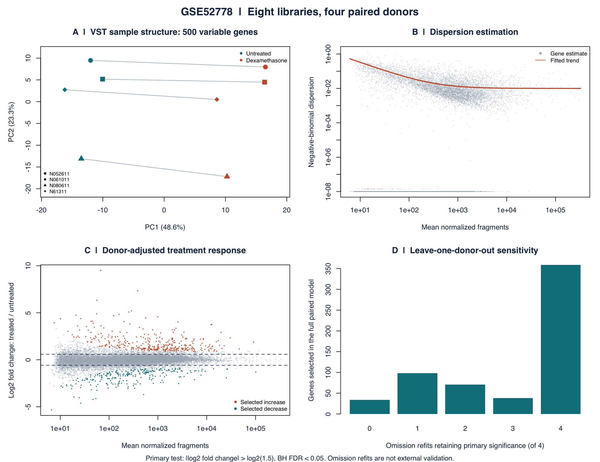

# Project 10: Paired RNA-seq Glucocorticoid Response Analysis

## Project overview

This project quantified dexamethasone-associated expression changes in primary
human airway smooth-muscle cells using genuine RNA-seq fragment counts from
GSE52778. A donor-adjusted negative-binomial model, an explicit effect-size
hypothesis, sample-level principal-component analysis, and donor-omission refits
were used to separate a strong treatment signal from uncertainty due to the
small number of biological donors.

The analysis identified **600 genes** at BH FDR < 0.05 for a change exceeding
1.5-fold. **359** remained significant in all four donor-omission refits. These
are findings within one experiment, not independently validated biomarkers.

## Analytical question

Which genes show evidence that dexamethasone changes expression by more than
1.5-fold after accounting for donor, and how sensitive are these findings to
omitting an individual donor or ignoring the paired design?

## Biological or clinical context

Glucocorticoids affect inflammatory signalling in airway smooth muscle.
GSE52778 profiled four primary donor-derived cell lines under untreated,
dexamethasone, albuterol, and combined-treatment conditions. This analysis used
only the untreated and dexamethasone conditions: 1 micromolar dexamethasone for
18 hours, eight libraries, and four paired biological donors. The original
study describes four white male donors. This cell-culture experiment does not
measure asthma severity, patient treatment benefit, or individual clinical
response.

## Data source

| Resource | Exact identity and role |
| --- | --- |
| Original study | [NCBI GEO GSE52778](https://www.ncbi.nlm.nih.gov/geo/query/acc.cgi?acc=GSE52778); 16 public libraries in the original series |
| Raw sequencing archive | [SRA SRP033351](https://www.ncbi.nlm.nih.gov/sra?term=SRP033351); raw reads were not realigned in this project |
| Count-data distribution | [Bioconductor airway 1.32.0, release 3.23](https://bioconductor.org/packages/3.23/data/experiment/html/airway.html) |
| Download used | [Versioned archive on the official Posit mirror](https://bioconductor.posit.co/packages/3.23/data/experiment/src/contrib/airway_1.32.0.tar.gz); 24,756,071 bytes |
| Count reference | GRCh37.p13 / Ensembl release 75; STAR alignment and unstranded union-mode paired-fragment counting documented by airway |
| Genuine subset | All 63,677 gene rows in the airway object and its eight untreated/dexamethasone libraries; no albuterol libraries |

Archive SHA-256:
`829f654fc8075ac9d810574e8a8d4672e69e847c45fa2ce598d1ffbc30c7fe19`.
The primary Bioconductor download returned HTTP 403 during retrieval; the
[officially listed mirror](https://bioconductor.org/about/mirrors/) supplied the
same versioned package. No alternate dataset or estimated counts were used.

The selected runs are SRR1039508, SRR1039509, SRR1039512, SRR1039513,
SRR1039516, SRR1039517, SRR1039520, and SRR1039521. `data/samples.csv` links
each run to its GEO sample, donor, treatment, BioSample, and SRA experiment.
The three exported input tables are bundled for offline analysis.

## Reference or data-quality assessment

The GEO series was checked on **19 October 2026**: its live record reported
public status, accession GSE52778, and all 16 expected sample accessions.
`data/GSE52778_status_2026-10-19.soft` preserves that evidence. No suppressed or
withdrawn replacement record was used. Public status confirms availability,
not independent verification of biological quality.

Checks confirmed 63,677 unique gene IDs, eight unique run IDs, non-negative
integer counts, one complete pair for each donor, and no missing count values.
Assigned fragments per library ranged from 15,163,415 to 30,818,215. These are
fragments assigned to genes, not total sequenced reads or alignment rates.
The package's source counting procedure differs from the original study's
Cufflinks/FPKM processing; this is a new count-based analysis, not an attempt
to reproduce the paper's exact discovery count.

The reference is deliberately historical. Coordinates were not converted to
GRCh38 and symbols were not silently refreshed. The January 2023 labels supplied
in airway were retained; stable Ensembl gene IDs are the primary keys. No
base-quality, alignment, duplication, or sample-identity audit of FASTQ/BAM
files was performed. The tiny example BAM files inside the package were not
used as the count source.

## Data usage

The airway package declares **LGPL** in its original `DESCRIPTION`, retained in
`data/airway_DESCRIPTION`. Attribution and usage notes are in
`DATA_USAGE.md`. NCBI places no restrictions on GEO use or distribution, while
noting that submitter-held intellectual-property rights may apply; see its
[disclaimer](https://www.ncbi.nlm.nih.gov/geo/info/disclaimer.html). The underlying
study and data-package authors are credited in References. Public genomic
identifiers were used without attempting donor re-identification. This work
makes no claim of unrestricted commercial or clinical authorization.

## Methods

- Retained genes with at least 10 fragments in at least four of eight libraries:
  **16,139** genes. This rule was fixed before examining differential results.
- Estimated median-of-ratios library size factors and fitted DESeq2 with
  `~ donor + dex`, untreated as the reference, parametric dispersion trend,
  empirical-Bayes dispersion moderation, and no count replacement.
- Tested the primary null `|log2 fold change| <= log2(1.5)` with the two-sided
  threshold Wald test. BH correction covered all 16,139 retained hypotheses;
  unavailable p values would count as non-rejections and remain unavailable
  in exports. Independent filtering was disabled. All primary p values were
  available, and every coefficient converged.
- Reported point-null tests separately. Log2 fold changes are unshrunk maximum
  likelihood estimates; 95% Wald intervals are marginal, not simultaneous.
- Applied a design-aware variance-stabilizing transformation (VST) only for
  exploration. PCA used the 500 most variable retained genes, with centered
  samples and no gene-wise variance scaling. VST was not used for testing.
- Refit `~ dex` as an unpaired-design sensitivity comparison and refit the
  paired model after removing both libraries from each donor. All refits
  re-estimated normalization and dispersions, retaining the original gene
  family. No significance optimization or donor exclusion was performed.

Detailed model equations, decisions, file flow, and checks are recorded in
[ANALYSIS_WORKFLOW.md](ANALYSIS_WORKFLOW.md).

## Results

| Measure | Verified result |
| --- | ---: |
| Biological donors / analyzed libraries | 4 / 8 |
| Source gene rows / retained genes | 63,677 / 16,139 |
| Point-null BH FDR < 0.05 | 4,068 |
| Primary effect-threshold BH FDR < 0.05 | 600 |
| Primary increases / decreases | 352 / 248 |
| Primary genes with matching direction in all omission refits | 600 |
| Primary genes significant in all four omission refits | 359 |
| Unpaired-design primary discoveries | 292 |
| Shared paired/unpaired primary discoveries | 289 |
| PCA variance explained by PC1 / PC2 | 48.58% / 23.27% |

Of the 600 primary genes, 34, 98, 71, 38, and 359 were significant in zero,
one, two, three, and four omission refits, respectively. Sign stability is
therefore much more common than significance stability. Paired and unpaired
log2 fold changes had Spearman correlation 0.9946; discovery counts still
changed substantially because the models account for different sources of
variability.



The principal-component plot connects samples from the same donor. The MA plot
shows fitted changes against mean normalized counts. The donor-response figure
reports numerical within-donor log2 ratios for the 12 genes with the smallest
primary q values; those descriptive ratios use a 0.5 pseudocount and are not
the fitted model coefficients.

## Interpretation

The experiment contains a substantial dexamethasone-associated transcriptional
signal after accounting for donor. The effect-threshold test yielded fewer
findings than the point-null test because it asks for evidence of a change
larger than a declared magnitude, rather than evidence of any nonzero change.
Known glucocorticoid-responsive genes such as DUSP1, KLF15, PER1, FKBP5, and
CRISPLD2 were present among selected increases, providing biological context
rather than an independent validation test.

Accounting for donor changed inference despite very similar effect rankings.
The paired model has three residual degrees of freedom; each omission fit has
only two. Loss of significance can reflect reduced precision as well as donor
influence and is not proof that a gene is false. Conversely, repeated
significance across overlapping refits does not establish replication.

## Output files

| Files under `outputs/` | Purpose |
| --- | --- |
| `analysis_summary.csv`, `analysis_report.md` | Reconciled counts and concise findings |
| `sample_qc.csv`, `gene_filter.csv`, `model_specification.csv` | Library summaries, filtering decisions, and model dimensions |
| `paired_differential_expression.csv`, `selected_response_genes.csv` | Complete retained-gene results and primary selection |
| `unpaired_design_results.csv`, `design_comparison.csv` | Design sensitivity |
| `leave_one_donor_out.csv` | All four refits, including coefficients, tests, and selections |
| `normalized_counts.csv`, `donor_log2_ratios.csv` | Normalized values and descriptive within-donor contrasts |
| `dispersion_estimates.csv`, `influence_diagnostics.csv` | Dispersion and Cook's-distance diagnostics |
| `pca_scores.csv`, `pca_variance.csv`, `pca_features.csv`, `sample_distances.csv` | Sample exploration and exact feature selection |
| `rnaseq_response_overview.*`, `donor_response_top_genes.*` | Inspected PNG/SVG figures |
| `session_info.txt`, `test_results.txt`, `validation_report.md` | Runtime and verification evidence |

## Reproducibility

<!-- Project 10 threshold-method compatibility correction -->
### Threshold-test compatibility

Project 10 preserves the conservative 2014 threshold Wald test used in its
original DESeq2 1.42.0 analysis. DESeq2 1.44.0 changed the implementation behind
`greaterAbs`; this project explicitly uses `greaterAbs2014` on DESeq2 >= 1.44.0
and `greaterAbs` on earlier releases. The choice preserves the original
statistical procedure; it does not tune the analysis to a target gene count.
Other differences across software environments may still affect numerical values.

An independent calculation using the original fitted coefficients reproduces
600 primary genes and 359 selected in every donor-omission refit with the
original method, versus 687 and 396 with the newer method. The newer method
also yields 391 increases, 296 decreases, and 340 unpaired discoveries, matching
the reported DESeq2 1.52.0 rerun. These are different implementations of the
same interval-null hypothesis, rather than a change to the source data.

The test suite now includes an additional check that exported threshold
p-values match the original normal-tail formula across all six fitted models.
Run the analysis before the tests after applying this correction; the suite
should then report 24 tests. Original 23-test logs describe the original release.

Source: [DESeq2 release notes, version 1.44.0](https://github.com/thelovelab/DESeq2/blob/devel/NEWS).


R **4.3 or newer** is required. The verified environment used R 4.3.3,
DESeq2 1.42.0, SummarizedExperiment 1.32.0, and digest 0.6.34. The data were
exported from airway 1.32.0 without installing that data package. A newer R
installation can use its compatible Bioconductor release; exact numerical
agreement across newer DESeq2 releases is not guaranteed.

```bash
Rscript --vanilla install_dependencies.R
Rscript --vanilla tests/test_rnaseq.R
Rscript --vanilla analyze_rnaseq.R
```

Optional source reconstruction downloads about 25 MB:

```bash
Rscript --vanilla retrieve_data.R retrieved_data
```

A separate output directory supports an independent rerun:

```bash
Rscript --vanilla analyze_rnaseq.R rerun_outputs
Rscript --vanilla verify_outputs.R outputs rerun_outputs
```

The delivered analysis passed **23 automated tests**. Source reconstruction
reproduced the three input-table hashes. A clean R rerun reproduced all 17
numerical CSV files byte-for-byte in the verified environment. An independent
Python/SciPy audit reconciled normalization, both Wald tests, and BH correction.
The optional audit runs with `python3 tests/audit_numerics.py` after installing
`requirements-validation.txt` in a separate Python 3.12 environment. It is not
required for the R workflow. See `outputs/validation_report.md` for verification
scope and tolerances.

## Technical competencies demonstrated

Versioned data acquisition; source and reference assessment; integer count
validation; donor-aware experimental design; negative-binomial modelling;
dispersion moderation; effect-size hypothesis testing; multiple-testing
control; dimensionality reduction; influence and design sensitivity;
automated testing; reproducible reporting; cautious biological interpretation.

## Limitations

Four donors provide limited precision and population representation. Treatment
was measured in cultured cells at one dose and time point. The model assumes a
common treatment effect after donor adjustment; a separate donor-by-treatment
interaction cannot be estimated with one library per donor-condition cell.
There is no independent cohort, clinical endpoint, prediction model, or
causal mediation analysis. Historical counting and annotation choices affect
the target estimand. Median-of-ratios normalization assumes that a suitable
reference set of genes is stable; without external absolute-expression
calibration, global expression shifts are not identifiable. FDR control is
model dependent, and the additional descriptive sensitivity summaries do not
supply a new multiplicity-controlled validation claim.

## References

1. Himes BE et al. (2014). RNA-Seq transcriptome profiling identifies CRISPLD2
   as a glucocorticoid responsive gene that modulates cytokine function in
   airway smooth muscle cells. PLoS ONE 9:e99625.
   [doi:10.1371/journal.pone.0099625](https://doi.org/10.1371/journal.pone.0099625).
2. [GSE52778](https://www.ncbi.nlm.nih.gov/geo/query/acc.cgi?acc=GSE52778).
3. Love MI. [airway package](https://bioconductor.org/packages/airway/),
   [source-processing vignette](https://bioconductor.org/packages/3.23/data/experiment/vignettes/airway/inst/doc/airway.html),
   [doi:10.18129/B9.bioc.airway](https://doi.org/10.18129/B9.bioc.airway).
4. Love MI, Huber W, Anders S. (2014). Moderated estimation of fold change and
   dispersion for RNA-seq data with DESeq2. Genome Biology 15:550.
   [doi:10.1186/s13059-014-0550-8](https://doi.org/10.1186/s13059-014-0550-8).
5. [DESeq2 reference documentation](https://bioconductor.org/packages/release/bioc/vignettes/DESeq2/inst/doc/DESeq2.html).
6. [NCBI GEO usage disclaimer](https://www.ncbi.nlm.nih.gov/geo/info/disclaimer.html).
