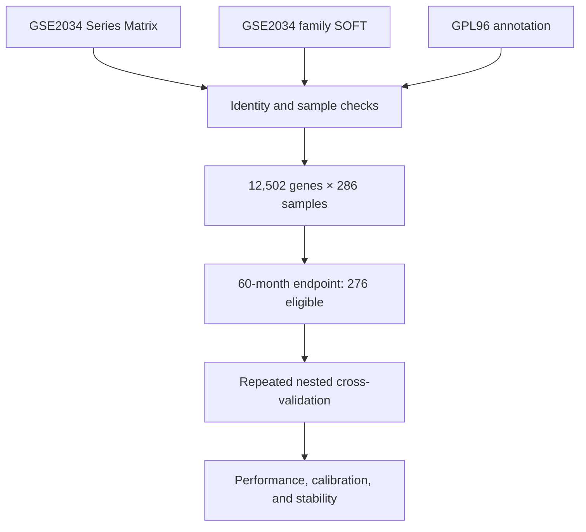

# Analysis Workflow: Nested-Validated Breast-Tumor Relapse Classification

## Scope and analytical target

This workflow evaluates whether processed tumor expression in GSE2034 can
discriminate relapse by a fixed 60-month landmark. The estimand is predictive
performance within the deposited cohort under repeated nested cross-validation.
It is not a survival-effect estimate, an external validation, or a clinical
deployment study.

The primary model uses expression only. ER status is evaluated separately as a
simple clinical comparator. A training-fold prevalence model provides a null
probability comparator for the Brier score.

## Source flow



The raw downloads are not silently replaced. `retrieve_data.py` requires exact
SHA-256 identities before deriving the checked files in `data/`. If NCBI updates
one of the records, retrieval stops and requires a documented source review.

## Source validation

Three public objects are pinned in `data/source_manifest.csv`:

- the GSE2034 processed Series Matrix;
- the GSE2034 family SOFT record containing the patient table; and
- the GPL96 platform annotation.

The parser verifies that the expression table exists, identifiers are unique,
all values are finite, and the 286 GSM columns reconcile exactly with the 286
clinical rows. The platform parser requires the probe ID, Gene ID, and gene
symbol fields used by the mapping rule.

The GSE2034 summary describes 180 relapse-free and 106 distant-metastasis cases.
The deposited patient table instead contains 179 `relapse = 0` and 107
`relapse = 1` rows. Because neither the source record nor this secondary analysis
can establish why they differ, the workflow uses the row-level table and labels
the endpoint relapse. The discrepancy is retained as data-quality evidence.

## Endpoint construction

Let (T_i) be the deposited time to relapse or last follow-up in months and
(R_i\in\{0,1\}) the deposited relapse indicator. The five-year outcome is

\[
Y_i =
\begin{cases}
1, & R_i=1 \text{ and } T_i\le 60,\\
0, & T_i\ge 60 \text{ and no relapse occurred by 60 months},\\
\text{unobserved}, & R_i=0 \text{ and } T_i<60.
\end{cases}
\]

A participant who relapsed after 60 months is negative for this fixed-horizon
endpoint because the participant was event-free through the landmark. This does
not imply lifelong non-relapse. Ten early-censored non-events are excluded,
leaving 95 positive and 181 negative outcomes.

## Expression representation

The deposited values are processed positive signal intensities. Each value is
transformed as

\[
X_{gs}=\log_2(\text{signal}_{gs}+1).
\]

GPL96 probes are retained only when the annotation contains one numeric Entrez
Gene ID and one non-empty, unambiguous symbol. When several probes map to one
Entrez ID, the representative probe is the probe with the largest across-sample
interquartile range:

\[
\operatorname{IQR}_g=Q_{0.75}(X_g)-Q_{0.25}(X_g).
\]

Probe ID is the deterministic tie-breaker. The relapse outcome is not used in
this collapse. The resulting 12,502-gene matrix is stored in
`data/expression_genes.csv.gz`; exact lineage and hashes are in
`data/derived_manifest.csv`.

This across-sample, outcome-blind collapse uses the complete cohort and is best
viewed as a fixed platform representation. All supervised feature selection is
performed separately inside each training fold.

## Repeated nested cross-validation

### Outer resampling

The outer design is five-fold stratified cross-validation repeated three times
with seed 20261026. Each repeat partitions all 276 eligible participants so that
every participant receives exactly one held-out prediction. Across three repeats,
the workflow produces 828 held-out predictions and 15 independently fitted outer
models.

For participant-level reporting, the three held-out probabilities are averaged:

\[
\bar p_i=\frac{1}{3}\sum_{r=1}^{3}p_{ir}.
\]

The standard deviation across the three values is also retained. Performance is
estimated from (Y_i) and (ar p_i), not from in-sample fitted values.

### Inner model selection

Within each outer training set, a four-fold shuffled stratified inner loop selects:

- the 25, 50, or 100 genes with the largest training-fold ANOVA F statistics;
- L1 or L2 logistic-regression regularization; and
- inverse regularization strength (C\in\{0.01,0.1,1\}).

The optimization score is inner-fold AUROC. The selected pipeline is refitted on
the complete outer training set and evaluated once on the untouched outer test
fold.

The pipeline order is supervised feature selection, standardization using the
training mean and standard deviation, and class-weighted logistic regression.
Because every learned operation is contained in the pipeline passed to the inner
search, test-fold expression and outcomes cannot affect feature scores, scaling
parameters, hyperparameter choice, or model coefficients.

## Comparator models

The ER-status-only comparator is fitted in each outer training fold and predicts
the matching test fold. It receives the same outer partitions but no inner search.
The training-prevalence comparator assigns every held-out participant the event
fraction observed in that participant's training fold. Both comparators are
aggregated across repeats in the same manner as the expression model.

These comparisons are descriptive. The project does not use a paired bootstrap
test to claim expression's incremental clinical value over ER status.

## Performance measures

### Discrimination

AUROC estimates the probability that a randomly chosen five-year relapse receives
a larger score than a randomly chosen non-event. Average precision summarizes
precision across recall levels and should be interpreted relative to the event
prevalence of (95/276=0.344).

### Probability accuracy

The Brier score is

\[
\operatorname{Brier}=\frac{1}{n}\sum_{i=1}^{n}(Y_i-\bar p_i)^2.
\]

Lower values indicate better probability accuracy. Unlike AUROC, the Brier score
penalizes poor calibration and is directly compared with the training-prevalence
model.

### Threshold measures

Sensitivity, specificity, and balanced accuracy are reported at probability 0.5.
This threshold was not optimized, has no asserted clinical utility, and is
included only as a familiar descriptive reference.

### Calibration

Calibration-in-the-large and calibration slope are estimated by fitting

\[
\operatorname{logit}\{P(Y_i=1)\}=\alpha+\beta\operatorname{logit}(\bar p_i).
\]

Ideal values are (alpha=0) and (eta=1). A negative intercept indicates
systematic overprediction on this scale; a slope below one indicates predictions
that are too extreme. A quantile-binned calibration curve is also exported, but
the fitted intercept and slope are the principal calibration summaries.

### Uncertainty

Two thousand participant-level stratified bootstrap samples preserve the number
of events and non-events. Percentile 2.5th and 97.5th quantiles form the reported
intervals. The predictions are treated as fixed after repeated CV. These intervals
therefore describe sampling variation in the evaluated predictions and do not
fully reproduce model development in every bootstrap sample.

## Feature stability

For each outer model, the selected gene set and standardized logistic coefficient
are retained. For gene (g), selection stability is

\[
S_g=\frac{\text{outer models selecting }g}{15}.
\]

Sign consistency is the larger of the positive- and negative-coefficient
fractions among models that selected the gene. Selection in at least 80% of
outer models is reported as a descriptive stability threshold. A high value does
not establish causal or prospective biomarker validity.

## Verified results

The complete run produced:

- 276 eligible participants, including 95 five-year relapses;
- 12,502 available gene-level features;
- 15 outer models and 828 repeat-specific held-out predictions;
- expression AUROC 0.650 (95% CI 0.581–0.713);
- expression average precision 0.487 (95% CI 0.415–0.572);
- expression Brier score 0.235 versus 0.226 for training prevalence;
- calibration intercept −0.623 and slope 0.628;
- ER-status-only AUROC 0.476; and
- 11 genes selected in at least 12 of 15 outer models.

The combination of moderate AUROC and inferior Brier performance is central to
the interpretation: ranking performance alone does not make the probabilities
decision-ready.

## Automated validation

The 16 unit and data-integrity tests cover:

- exact landmark handling, early censoring, and late relapse;
- invalid outcome, duplicate sample, and non-finite expression rejection;
- stable SHA-256 calculation;
- authentic analytical dimensions and GSM reconciliation;
- preserved source relapse counts and derived five-year counts;
- unique representative probes and genes;
- plausible transformed expression range;
- repeated nested-CV prediction coverage;
- fold-specific feature-count accounting;
- repeated-prediction aggregation;
- bootstrap interval ordering; and
- feature-stability denominators and sign consistency.

`verify_outputs.py` independently recomputes AUROC, average precision, and Brier
score from `oof_predictions.csv`, reconciles selected-feature counts with each
fold's chosen hyperparameter, and checks output coverage and run metadata.

## Reproduction commands

From the project directory:

```bash
python3 -m venv .venv
source .venv/bin/activate
python3 -m pip install -r requirements.txt
python3 analyze_breast_relapse.py
python3 -m unittest discover -s tests -v
python3 verify_outputs.py
```

To regenerate the analytical files from their authoritative source:

```bash
python3 retrieve_data.py
python3 analyze_breast_relapse.py
```

`data/cache/` is ignored because the three pinned raw files total approximately
84 MB. Retrieval fails closed if any SHA-256 identity differs.

## Interpretation limits

The analysis does not establish external transportability, calibration in a new
health system, prospective utility, assay equivalence, or treatment benefit.
Clinical covariates are sparse, the platform is historical, and deposited
processed data cannot resolve laboratory batch effects or tumor composition.
Any next-stage model should be locked and assessed in a separately collected,
clinically compatible cohort before decision thresholds are discussed.
