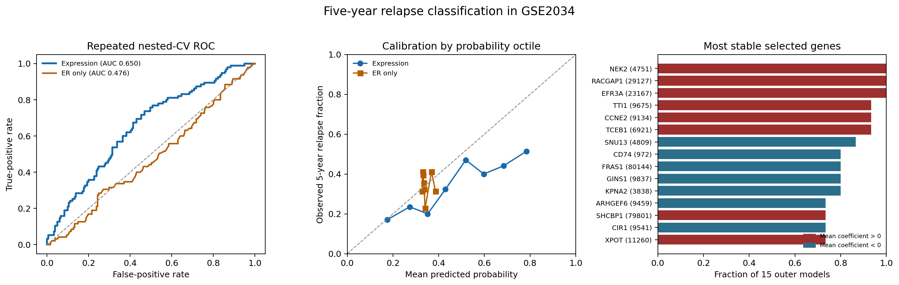

# Project 11: Nested-Validated Breast-Tumor Relapse Classification

## Project overview

This project developed and internally validated a high-dimensional gene-expression
classifier for five-year relapse in the public NCBI GEO breast-tumor cohort
GSE2034. It used the complete deposited processed matrix, reconciled 286 sample
accessions with the clinical table, mapped GPL96 probes to unambiguous Entrez Gene
IDs, and evaluated an outcome-blind gene representation through repeated nested
cross-validation.

The principal result is deliberately two-sided. The expression model showed
moderate discrimination, with AUROC **0.650** (95% CI 0.581–0.713), but its Brier
score was **0.235**, worse than the training-prevalence comparator's **0.226**.
Its calibration slope of **0.628** and intercept of **−0.623** also indicated
overly extreme and systematically high predicted probabilities. The workflow
therefore does not present the model as clinically deployable.

## Analytical question

Can a leakage-controlled gene-expression model discriminate relapse by 60 months
among GSE2034 participants whose five-year status is observable, and does its
absolute-risk performance improve on simple non-expression comparators?

## Biological or clinical context

Lymph-node-negative breast cancer has heterogeneous outcomes. Expression profiles
can capture proliferation, hormone-receptor biology, immune composition, and
other tumor programs associated with relapse risk. Retrospective discrimination
within one cohort, however, does not establish generalizability across platforms,
clinical settings, ancestry groups, or treatment eras.

The endpoint was defined before modelling. A relapse at or before 60 months was
positive. Participants known to be event-free through 60 months were negative at
that landmark, including those who relapsed later. Ten relapse-free participants
censored before 60 months were excluded rather than silently assigned to the
negative class.

## Data source

| Record | Exact public source | Analysis use |
| --- | --- | --- |
| GSE2034 | [Breast cancer relapse-free survival](https://www.ncbi.nlm.nih.gov/geo/query/acc.cgi?acc=GSE2034) | 286 processed tumor profiles and patient clinical table |
| GPL96 | [Affymetrix Human Genome U133A Array](https://www.ncbi.nlm.nih.gov/geo/query/acc.cgi?acc=GPL96) | Probe-to-gene annotation |
| Original study | Wang et al., PMID [15721472](https://pubmed.ncbi.nlm.nih.gov/15721472/) | Cohort and scientific context |

The exact source URLs, retrieval date (**2026-10-26**), byte counts, and SHA-256
hashes are recorded in `data/source_manifest.csv`. `retrieve_data.py` downloads
and verifies the three pinned source files before regenerating the repository's
analytical matrix.

## Reference or data-quality assessment

GSE2034 and GPL96 were active public records when checked on 2026-10-26. The
source data reconciled as follows:

- 286 unique GSM sample columns and 22,283 unique probes;
- 286 patient-table rows matched one-to-one to expression columns;
- all samples were lymph-node negative and all expression values were finite;
- 12,502 unambiguous Entrez Gene IDs remained after deterministic probe collapse;
- the clinical table contained 107 relapse events, whereas the series summary
  describes 106 distant-metastasis cases.

The last discrepancy is not silently resolved. This project uses the deposited
row-level relapse field and describes the endpoint as relapse rather than distant
metastasis. The dated assessment is retained in `data/reference_assessment.csv`.

## Data usage

NCBI states that it places no restrictions on GEO data use or distribution,
while warning that submitters may hold rights in portions of deposited material.
The accessions and original publication are cited, and no universal Creative
Commons license is claimed. See [DATA_USAGE.md](DATA_USAGE.md) for provenance,
privacy boundaries, and endpoint handling.

## Methods

1. The complete GSE2034 Series Matrix, family SOFT record, and GPL96 annotation
   were downloaded and checked against pinned SHA-256 identities.
2. Processed signal intensities were transformed as `log2(signal + 1)`.
3. Probes were restricted to one numeric Entrez Gene ID and one unambiguous gene
   symbol. For genes with multiple probes, the probe with the largest across-sample
   interquartile range was selected without using the relapse outcome.
4. The 60-month endpoint retained 276 participants: 95 relapses by 60 months and
   181 participants event-free through that landmark.
5. The expression model used three repeats of five-fold stratified outer
   cross-validation. Each training fold performed its own four-fold inner search
   over 25, 50, or 100 ANOVA-selected genes, L1 or L2 logistic regression, and
   three regularization strengths. Scaling, supervised feature selection, and
   model fitting occurred inside the resampling pipeline.
6. Each participant received one held-out prediction per repeat. The three
   probabilities were averaged for participant-level performance estimation.
7. AUROC, average precision, Brier score, threshold metrics, calibration
   intercept, and calibration slope were reported with 2,000 stratified bootstrap
   intervals. ER-status-only and training-prevalence comparators used the same
   outer splits.
8. Feature stability was summarized across all 15 outer models rather than
   interpreting one fitted coefficient vector as a definitive signature.

Detailed formulae, leakage controls, data flow, and validation checks are in
[ANALYSIS_WORKFLOW.md](ANALYSIS_WORKFLOW.md).

## Results

| Verified measure | Result |
| --- | ---: |
| Source / endpoint-eligible samples | 286 / 276 |
| Five-year relapse / non-relapse | 95 / 181 |
| Early-censored participants excluded | 10 |
| Gene-level features available | 12,502 |
| Outer models | 15 |
| Expression AUROC | 0.650 (95% CI 0.581–0.713) |
| Expression average precision | 0.487 (95% CI 0.415–0.572) |
| Expression Brier score | 0.235 (95% CI 0.215–0.256) |
| Training-prevalence Brier score | 0.226 |
| Calibration intercept / slope | −0.623 / 0.628 |
| ER-status-only AUROC | 0.476 (95% CI 0.404–0.547) |
| Genes selected in at least 80% of outer models | 11 |

NEK2 and RACGAP1 were selected in every outer model, but selection frequency is
not evidence of causal relevance or independent biomarker validation. Several
frequently selected genes had unstable coefficient direction, reinforcing the
need to distinguish selection recurrence from a stable signed effect.



## Interpretation

The expression model ranked five-year relapse risk better than chance on average,
but the confidence interval indicates substantial uncertainty. More importantly,
its absolute probabilities were unreliable: the negative calibration intercept
is consistent with overprediction, the slope below one indicates excessive
spread, and the Brier score was worse than the training-prevalence comparator.

This contrast matters operationally. A model may separate higher- from lower-risk
participants while still producing risk values unsuitable for decisions. The
results support further external evaluation and recalibration research, not a
clinical risk tool or treatment recommendation.

## Output files

| File in `outputs/` | Contents |
| --- | --- |
| `analysis_summary.csv` | Principal cohort, modelling, and performance results |
| `oof_predictions.csv` | Participant-level mean held-out probabilities across three repeats |
| `oof_predictions_by_repeat.csv` | All 828 repeat-specific held-out predictions |
| `outer_fold_results.csv` | Inner-selected hyperparameters and outer-fold AUROC |
| `outer_fold_selected_features.csv` | Selected genes and coefficients for all outer models |
| `feature_stability.csv` | Selection frequency and coefficient-sign stability |
| `expression_performance.csv` | Metrics and stratified bootstrap intervals |
| `er_baseline_performance.csv` | ER-status-only comparator performance |
| `prevalence_baseline_performance.csv` | Training-prevalence comparator performance |
| `expression_roc_curve.csv` | Coordinates for the expression ROC curve |
| `expression_calibration_curve.csv` | Quantile calibration points |
| `nested_relapse_classification.png` and `.svg` | ROC, calibration, and stability figure |
| `analysis_report.md` | Generated numerical interpretation |
| `run_metadata.json` | Runtime, seed, design, and input identities |
| `test_results.txt` | Verified 16-test run |

## Reproducibility

Python 3.10 or newer is required. The bundled genuine derived data permit an
offline analysis run:

```bash
python3 -m venv .venv
source .venv/bin/activate
python3 -m pip install -r requirements.txt
python3 analyze_breast_relapse.py
python3 -m unittest discover -s tests -v
python3 verify_outputs.py
```

To re-download and regenerate the analytical data from NCBI GEO first:

```bash
python3 retrieve_data.py
```

The full downloads total approximately 84 MB and are stored in ignored
`data/cache/`. `make all` runs the analysis, tests, and output audit.

## Technical competencies demonstrated

Authoritative GEO retrieval; source hashing; SOFT and Series Matrix parsing;
clinical-endpoint construction under right censoring; probe-to-gene mapping;
outcome-blind representation; leakage-controlled nested cross-validation;
regularized logistic regression; repeated held-out prediction; discrimination,
calibration, and Brier assessment; comparator models; participant bootstrap
intervals; feature-stability analysis; automated testing; and reproducible reporting.

## Limitations

- This is internal validation in one retrospective cohort and one historical
  microarray platform; there is no external test cohort.
- A binary five-year endpoint is transparent but discards follow-up information.
  A survival model would answer a different time-to-event question.
- The public summary and row-level clinical table disagree by one event and use
  different terminology; the analysis cannot determine the underlying cause.
- Processed deposited signals were used. Raw CEL preprocessing, laboratory batch
  correction, and tumor-purity adjustment were not repeated.
- The cohort predates current treatment patterns, and important clinical
  covariates were unavailable or not used.
- Repeated cross-validation predictions are correlated, and bootstrap intervals
  treat the participant-level averaged predictions as fixed model outputs.
- Feature-selection stability does not establish biological mechanism, causal
  relevance, assay validity, or prospective clinical benefit.

## References

1. Wang Y, et al. Gene-expression profiles to predict distant metastasis of
   lymph-node-negative primary breast cancer. *Lancet*. 2005;365:671–679.
   [PMID 15721472](https://pubmed.ncbi.nlm.nih.gov/15721472/).
2. NCBI GEO. [GSE2034](https://www.ncbi.nlm.nih.gov/geo/query/acc.cgi?acc=GSE2034).
3. NCBI GEO. [GPL96](https://www.ncbi.nlm.nih.gov/geo/query/acc.cgi?acc=GPL96).
4. NCBI GEO. [Data disclaimer](https://www.ncbi.nlm.nih.gov/geo/info/disclaimer.html).
